# Healthcare and Patient Risk Analysis

## Bài tập lớn Machine Learning

Sinh viên / mã lớp: điền thông tin trước khi nộp. Ngày thực nghiệm: 11/10/2026.

Hai nghiên cứu tình huống: Heart Cleveland và Diabetes 130-US Hospitals. Số liệu lấy từ artifact thực nghiệm đã khóa.

## 1. Tóm tắt và câu hỏi nghiên cứu

Đề tài nghiên cứu hai nhiệm vụ phân loại trên dữ liệu y tế dạng bảng: nhận diện bệnh tim đã hiện diện trong Cleveland và xếp hạng khả năng tái nhập viện sớm theo mã <30 ở các lượt xuất viện có đái tháo đường. Hai tập có nhãn, thời kỳ và quần thể khác nhau; chúng tạo hai nghiên cứu tình huống, không phải external validation của một mô hình chung.

Mô hình logistic được chọn bằng CV development, không chọn bằng test. Test roc_auc=0.9621, ROC-AUC=0.9621, AP=0.9563. Tại threshold 0.269344, TP=28, TN=19, FP=14, FN=0; recall=1.0000, precision=0.6667, specificity=0.5758, tỷ lệ gắn cờ=68.85%. Test nhỏ nên recall quan sát bằng 1 không chứng minh sensitivity quần thể bằng 100%. Không dựng ca FN khi không có FN.

Mô hình xgboost được chọn bằng CV development, không chọn bằng test. Test ap=0.2289, ROC-AUC=0.6695, AP=0.2289. Tại threshold 0.090540, TP=1788, TN=7983, FP=9729, FN=531; recall=0.7710, precision=0.1552, specificity=0.4507, tỷ lệ gắn cờ=57.50%. Đánh giá encounter-level trên bệnh nhân chưa xuất hiện ở phần fit. Ranking còn khiêm tốn và tải false alarm cao; chưa chứng minh hiệu ích lâm sàng.

Đóng góp chính là quy trình kiểm toán: chia dữ liệu theo đơn vị quan sát, học toàn bộ preprocessing trong fold, tách calibration và threshold khỏi fit, khóa recipe trước test, lưu predictions và dùng bootstrap phù hợp cấu trúc bệnh nhân. Kết quả bao gồm cả phương pháp không cải thiện: feature engineering readmission giảm AP development; calibration Heart làm Brier test xấu hơn.

RQ1 so sánh mô hình theo ROC-AUC/AP; RQ2 phân tích imbalance và operating threshold; RQ3 kiểm tra xác suất; RQ4 tìm FP/FN và nhóm dễ sai; RQ5 đánh giá giá trị mở rộng so với chi phí và giả định. Không đặt một mức accuracy tùy ý làm điều kiện thành công.

T–E–P theo Slide1: T là từng bài toán phân loại; E là dữ liệu fit/development dùng học và lựa chọn; P là metric chính đánh giá độc lập. Prototype chỉ phục vụ nghiên cứu môn học, chưa được thẩm định để dùng lâm sàng.

**Hai nghiên cứu tình huống**

| Dataset         |    Raw |   Cohort |   Test | Primary   |
|:----------------|-------:|---------:|-------:|:----------|
| Heart Cleveland |    303 |      303 |     61 | ROC-AUC   |
| Readmission     | 101766 |    99340 |  20031 | AP        |

## 2. Dữ liệu Heart và ý nghĩa dự đoán

Nguồn UCI ID45, DOI10.24432/C52P4X, CC BY4.0. Dùng riêng processed Cleveland với 303 hàng gốc và 13 biến; target y=1 nếu num>0, y=0 nếu num=0. Không dùng bản sao đã nhân hàng và không chuyển nhãn 0–4 thành một đại lượng regression.

Numerical gồm age, trestbps, chol, thalach, oldpeak. Các mã cp, sex, fbs, restecg, exang, slope, ca, thal được coi là categorical theo data dictionary. Missing ? được đưa về NaN; imputer median/most frequent fit riêng trong train-fold. Số0 không bị coi là missing.

Các đầu vào như ca và thal liên quan quy trình xét nghiệm/chẩn đoán. Thực nghiệm đầy đủ giả định thông tin này đã sẵn có, không chứng minh khả năng sàng lọc trước xét nghiệm. Ablation restricted bỏ ca/thal để khảo sát mức phụ thuộc vào xét nghiệm chuyên sâu; vẫn không xác lập một quy trình triển khai lâm sàng.

ID audit được tạo theo hàng, không phải một định danh bệnh nhân đã xác thực. Mỗi hàng được giả định độc lập; không thể kiểm chứng người xuất hiện lặp bằng metadata hiện có. Test chỉ61 quan sát, vì vậy cần CI và tránh khẳng định ưu thế tuyệt đối từ chênh lệch nhỏ.

Phân phối development cho thấy các lớp còn chồng lấn về tuổi, cholesterol và huyết áp. Các liên hệ này mô tả dữ liệu, không chứng minh tác động nhân quả. Thống kê outlier không được dùng để tùy tiện loại các ca khó.

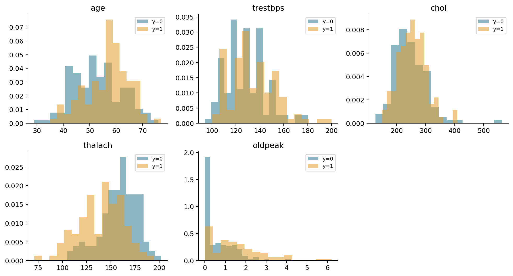

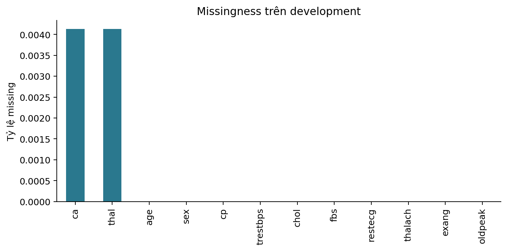

## 3. Dữ liệu tái nhập viện và xây dựng cohort

Nguồn UCI ID296, DOI10.24432/C5230J, CC BY4.0. Raw gồm101.766 lượt điều trị, không phải101.766 bệnh nhân độc lập. Target dương chỉ khi readmitted bằng <30; >30 và NO là âm. NO là nhãn quan sát trong hệ thống, không chứng minh không tái nhập viện ở ngoài hệ thống.

Thời điểm dự đoán là xuất viện. Dùng thông tin của encounter hiện tại có sẵn đến thời điểm này; không tổng hợp các encounter tương lai. encounter_id và patient_nbr không nằm trong feature matrix. patient_nbr chỉ dùng cho group split, kiểm toán và cluster bootstrap.

Đọc đúng section discharge_disposition_id trong IDS_mapping.csv; loại expired/hospice mã11,13,14,19,20,21 và3 hàng gender Unknown/Invalid. Giữ các trường hợp transfer; không bỏ nhóm phức tạp chỉ để tăng điểm. Cohort cuối có99.340 lượt và69.987 patient groups.

Giữ None ở biến xét nghiệm như trạng thái không ghi nhận xét nghiệm, tránh parser tự biến thành missing. Loại weight, payer_code, medical_specialty theo protocol vì thiếu thông tin/cardinality và mục tiêu nguồn lực. Numerical là số ngày hoặc counts; mã nhập viện, tuổi theo khoảng và diagnosis xử lý categorical.

Feature engineering gộp ICD theo nhóm trong nghiên cứu Strack2014, riêng mã V/E và missing; thêm tổng prior visits. Cách gộp có thể làm mất chi tiết chẩn đoán, nên phải có đối chứng cùng hyperparameters và folds.

**Dòng chảy cohort**

|   step | reason                                    |   rows_before |   rows_removed |   rows_after |
|-------:|:------------------------------------------|--------------:|---------------:|-------------:|
|      1 | Loại expired/hospice theo IDS_mapping.csv |        101766 |           2423 |        99343 |
|      2 | Loại gender Unknown/Invalid               |         99343 |              3 |        99340 |

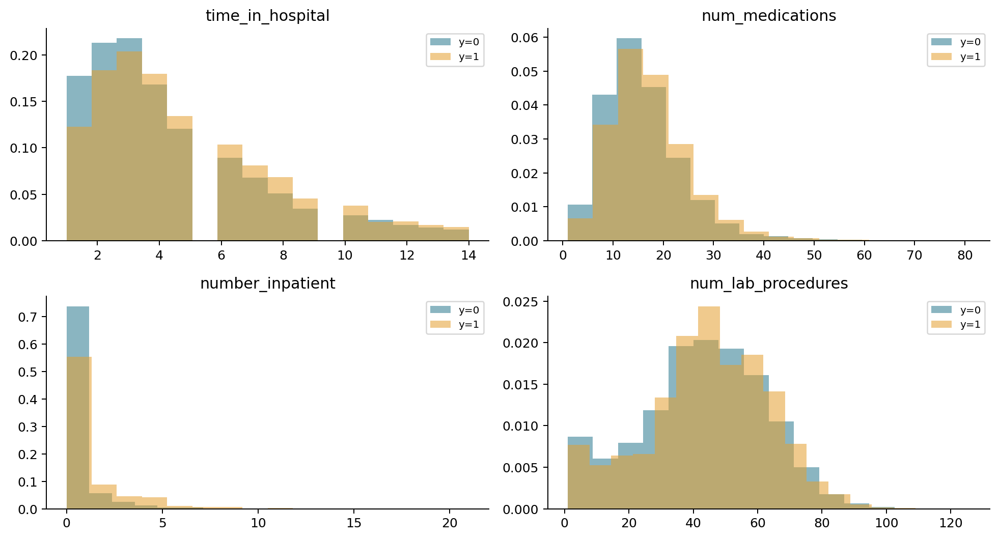

## 4. Protocol, cấu trúc dữ liệu và chống leakage

Protocol được ghi trước tuning/test. Heart giữ test20% stratified seed42; phần development được chia fit/tune169, calibration36, threshold37. Readmission giữ fold0 của StratifiedGroupKFold5 làm test; mọi lần chia nội bộ và CV tiếp tục tách patient_nbr. ID không được đưa vào model.

Model selection chỉ dùng fit/tune: Heart5 folds và readmission3 group folds, random search seed42. Imputer, encoder và scaler học lại trên train của mỗi fold. Các category mới ở validation/test được xử lý handle_unknown=ignore. Không resample validation/test; dự án không cần SMOTE để đáp ứng imbalance analysis.

Recipe cuối giữ model fit trên fit/tune, calibrator fit calibration và chọn threshold trên holdout riêng. Không refit toàn bộ development sau calibration, vì khi đó xác suất/threshold không còn độc lập với bộ huấn luyện đã đổi. Đổi lại, cỡ train nhỏ hơn và calibration Heart bất định do chỉ36 quan sát.

Sigmoid được giữ nếu Brier trên threshold holdout tốt hơn raw. Threshold tối đa F2; nếu hòa chọn ngưỡng lớn hơn. Freeze lưu hash models, split, processed data và mã biến đổi trước test. CV mean/SD là điểm lựa chọn, không phải estimate nested-CV không thiên lệch.

RF readmission ban đầu vượt ngân sách thời gian với max_features0.6 trên one-hot. Trước khi mở test readmission, thu hẹp sang sqrt,80 cây, depth8/12, leaf15/30,4 cấu hình. Cohort/folds/nhãn giữ nguyên; báo resource amendment và log run bị ngắt. Không tuyên bố tuning công bằng tuyệt đối theo CPU.

**Các vai trò dữ liệu độc lập**

| Dataset     | Role        |   Rows |   Groups |   Positive |   Prevalence |
|:------------|:------------|-------:|---------:|-----------:|-------------:|
| Heart       | fit         |    169 |      169 |         78 |        0.462 |
| Heart       | calibration |     36 |       36 |         16 |        0.444 |
| Heart       | threshold   |     37 |       37 |         17 |        0.459 |
| Heart       | test        |     61 |       61 |         28 |        0.459 |
| Readmission | fit         |  59372 |    42013 |       6649 |        0.112 |
| Readmission | calibration |  10083 |     7024 |       1194 |        0.118 |
| Readmission | threshold   |   9854 |     6999 |       1152 |        0.117 |
| Readmission | test        |  20031 |    13951 |       2319 |        0.116 |

## 5. Logistic Regression, tối ưu và regularization

Logistic Regression dùng score z=wᵀx+b và p=sigmoid(z). Log-odds tuyến tính theo features; xác suất liên tục và nhãn dự đoán là hai đối tượng khác nhau. Changing threshold không đổi p; class weighting hoặc regularization làm đổi model và có thể đổi p.

Bernoulli negative log-likelihood trung bình: J=mean(logaddexp(0,z)-y*z). Gradient w=Xᵀ(p-y)/n; gradient intercept=mean(p-y). Với L2 thêm lambda*w vào gradient w, không phạt intercept trong bản NumPy. Tính cả hai gradient trước khi cập nhật.

Bản NumPy dùng development numerical Heart, kiểm tra finite differences: sai số gradient tối đa 6.52e-11. Khi cùng objective không regularization và hội tụ, xác suất lệch tối đa 5.58e-09 so với LBFGS của thư viện. Đây là kiểm tra thuật toán, không phải điểm test mới.

L2 co hệ số; L1 có thể làm nhiều hệ số bằng0. C nhỏ tăng regularization trong API được cài; không mặc định lambda=1/C cho mọi quy ước chuẩn hóa objective. Quan hệ MAP/Gaussian prior chỉ đúng khi đặt likelihood/prior và scaling tương ứng; point estimate không phải posterior đầy đủ.

Scaling dùng train statistics. Learning-rate loss curve theo iteration chẩn đoán tối ưu; validation curve theo C đánh giá regularization; learning curve theo số quan sát đánh giá tác dụng thêm dữ liệu. Ba loại curve trả lời các câu hỏi khác nhau.

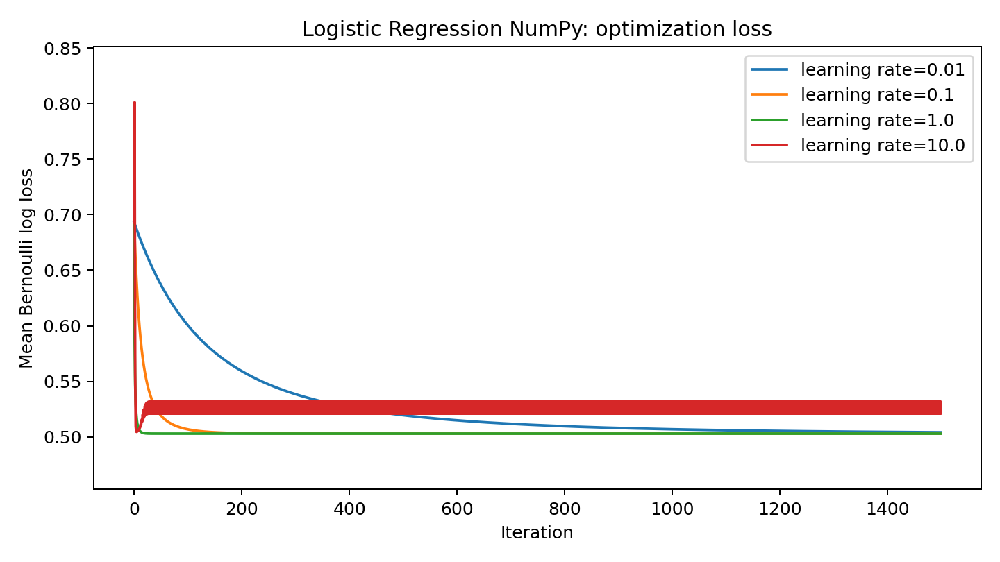

## 6. KNN và mô hình xác suất đã học

KNN phụ thuộc biểu diễn và khoảng cách: Manhattan dùng tổng sai khác tuyệt đối; Euclidean dùng căn tổng bình phương. Biến có đơn vị lớn có thể chi phối distance nếu không scaling. Numerical được chuẩn hóa trong fold, categorical one-hot; hình học ghép này vẫn là lựa chọn mô hình cần giải thích.

Thử k3/5/7/11/15/21, p1/2 và uniform/distance weighting trên cùng folds. k nhỏ nhạy với noise; k lớn làm trơn biên. Không chỉ nhìn training accuracy của k=1. Chiều cao và brute-force prediction cost khiến KNN readmission full là tùy chọn, không ép chạy để tăng số tên thuật toán.

Gaussian classifier dùng class priors và class-conditional Gaussian. Score gồm distance, covariance determinant và prior. GaussianNB giả định độc lập có điều kiện nên covariance chéo; QDA dùng covariance đầy đủ có regularization. Không coi các mã bệnh/categorical là Gaussian liên tục.

E10 so GaussianNB, QDA và LR trên cùng numerical features/folds. So với full-feature LR phải ghi feature_set để phân biệt hiệu quả thuật toán và lượng thông tin. Tương quan development gợi ý giả định độc lập có thể không hoàn hảo, nhưng không tự chứng minh NB sẽ kém ở mọi split.

GMM/EM xuất hiện trong Slide5 nhưng không cần triển khai một bài clustering riêng để đủ chương. Việc kết hợp supervised, xác suất, tối ưu và đánh giá đúng phù hợp hai outcome đã chọn.

**E10: cùng numerical features**

| variant         |   roc_auc |    ap |   brier |
|:----------------|----------:|------:|--------:|
| E10_gaussian_nb |     0.798 | 0.799 |   0.193 |
| E10_logistic    |     0.804 | 0.786 |   0.209 |
| E10_qda         |     0.807 | 0.809 |   0.185 |

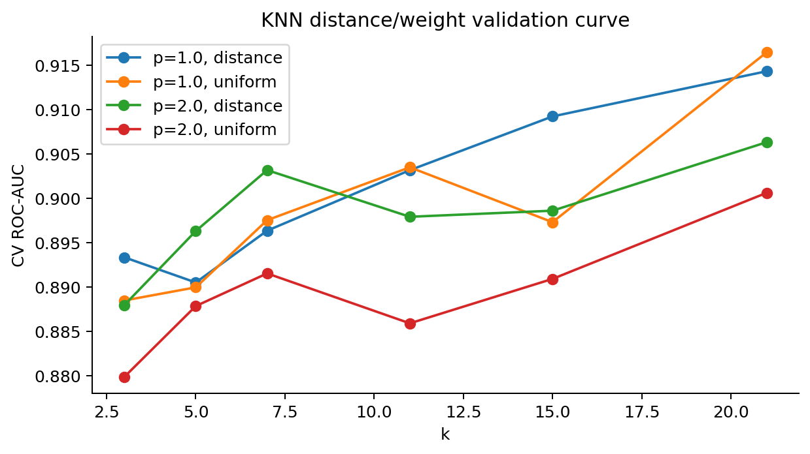

## 7. Lựa chọn mô hình trên development: Heart

Các họ model đã được định trước, dùng cùng CV splits trong dataset. Dummy prior/most frequent là mốc tham chiếu; các mô hình Gaussian dùng nhánh numerical. Các ablation weighted/restricted/engineered được ghi rõ, không trộn thành những thuật toán độc lập giả.

Metric chính là ROC-AUC. Selected bằng mean CV, quy tắc gần hòa trong0.002 ưu tiên đơn giản đã chốt. Winner development: logistic. Không chọn lại winner bằng test.

Mean fold và pooled OOF metric có thể khác. Bảng này chỉ báo mean/SD giữa folds; SD không phải CI95%. Tuning/feature comparison có selection optimism; assessment cuối dùng test độc lập. train_seconds bao gồm search, CV và refit, không phải latency một fit duy nhất.

Search budget hữu hạn: Heart tối đa12 cấu hình, readmission6, riêng RF4 sau điều chỉnh tài nguyên. Không có tuyên bố tối ưu toàn cục hoặc SOTA. Params đầy đủ và từng trial được lưu ở artifacts/runs để chạy lại, kèm warnings và dữ liệu/split hash.

**CV và nguồn lực**

| model               | feature_set   |   mean_score |   std_score |   train_seconds |
|:--------------------|:--------------|-------------:|------------:|----------------:|
| dummy               | full          |        0.5   |       0     |           0.265 |
| logistic            | full          |        0.919 |       0.023 |           1.454 |
| logistic_balanced   | full          |        0.919 |       0.023 |           1.367 |
| gaussian_nb         | numeric       |        0.798 |       0.041 |           0.359 |
| xgboost             | full          |        0.889 |       0.014 |           3.141 |
| knn                 | full          |        0.914 |       0.017 |           1.716 |
| knn_unscaled        | full          |        0.789 |       0.033 |           1.642 |
| qda                 | numeric       |        0.807 |       0.049 |           0.347 |
| logistic_numeric    | numeric       |        0.804 |       0.037 |           0.755 |
| logistic_restricted | restricted    |        0.889 |       0.032 |           1.268 |

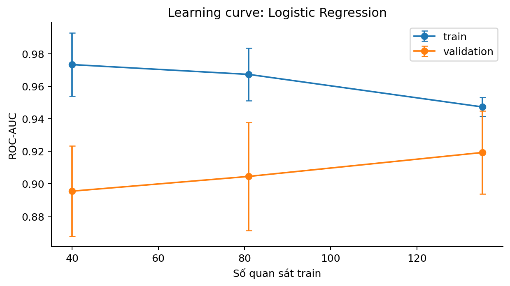

## 8. Lựa chọn mô hình trên development: Readmission

Các họ model đã được định trước, dùng cùng CV splits trong dataset. Dummy prior/most frequent là mốc tham chiếu; các mô hình Gaussian dùng nhánh numerical. Các ablation weighted/restricted/engineered được ghi rõ, không trộn thành những thuật toán độc lập giả.

Metric chính là Average Precision. Selected bằng mean CV, quy tắc gần hòa trong0.002 ưu tiên đơn giản đã chốt. Winner development: xgboost. Không chọn lại winner bằng test.

Mean fold và pooled OOF metric có thể khác. Bảng này chỉ báo mean/SD giữa folds; SD không phải CI95%. Tuning/feature comparison có selection optimism; assessment cuối dùng test độc lập. train_seconds bao gồm search, CV và refit, không phải latency một fit duy nhất.

Search budget hữu hạn: Heart tối đa12 cấu hình, readmission6, riêng RF4 sau điều chỉnh tài nguyên. Không có tuyên bố tối ưu toàn cục hoặc SOTA. Params đầy đủ và từng trial được lưu ở artifacts/runs để chạy lại, kèm warnings và dữ liệu/split hash.

**CV và nguồn lực**

| model               | feature_set   |   mean_score |   std_score |   train_seconds |
|:--------------------|:--------------|-------------:|------------:|----------------:|
| dummy               | full          |        0.112 |       0.004 |          15.975 |
| logistic            | full          |        0.213 |       0.006 |          69.808 |
| logistic_balanced   | full          |        0.214 |       0.005 |         244.709 |
| gaussian_nb         | numeric       |        0.189 |       0.005 |           1.462 |
| xgboost             | full          |        0.22  |       0.007 |         134.017 |
| random_forest       | full          |        0.212 |       0.007 |          99.874 |
| logistic_engineered | engineered    |        0.212 |       0.007 |          67.87  |

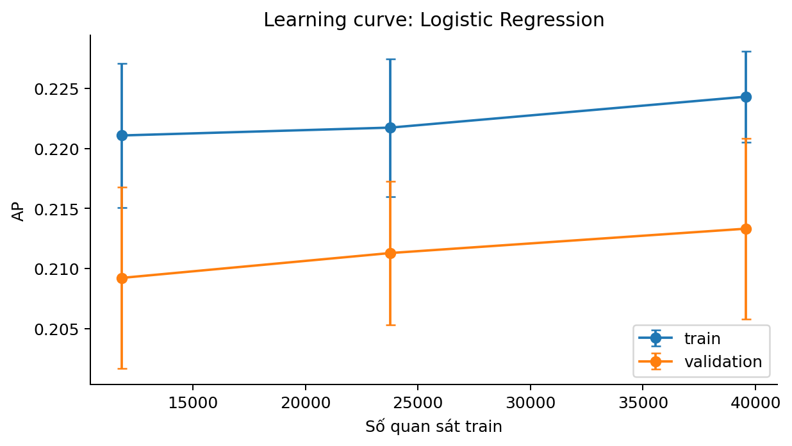

## 9. Đánh giá độc lập: Heart

Mô hình logistic được chọn bằng CV development, không chọn bằng test. Test roc_auc=0.9621, ROC-AUC=0.9621, AP=0.9563. Tại threshold 0.269344, TP=28, TN=19, FP=14, FN=0; recall=1.0000, precision=0.6667, specificity=0.5758, tỷ lệ gắn cờ=68.85%. Test nhỏ nên recall quan sát bằng 1 không chứng minh sensitivity quần thể bằng 100%. Không dựng ca FN khi không có FN.

Bảng dùng threshold của từng recipe được chọn trên development; không phải accuracy tại mặc định0.5. Dummy tối đa F2 gắn cờ tất cả, nên accuracy của nó ở operating point này khác always-negative0.5. Ranking AP/AUC vẫn là baseline không phụ thuộc threshold.

AUC cao ở test nhỏ hơn mức CV không chứng minh mô hình luôn tốt hơn. Kiểm tra IDs/target proxies và train-only pipeline đã đạt; các xét nghiệm chuyên sâu vẫn là hạn chế deployment. Sensitivity test1 từ28 positives có binomial exact CI95% khoảng0.877–1.000 dưới giả định độc lập. Bootstrap recall suy biến1–1 không chứng minh population sensitivity100%.

**Test của các recipe**

| model               | feature_set   |   roc_auc |    ap |   recall |   precision |
|:--------------------|:--------------|----------:|------:|---------:|------------:|
| dummy               | full          |     0.5   | 0.459 |    1     |       0.459 |
| logistic            | full          |     0.962 | 0.956 |    1     |       0.667 |
| logistic_balanced   | full          |     0.962 | 0.956 |    1     |       0.667 |
| gaussian_nb         | numeric       |     0.87  | 0.877 |    0.964 |       0.466 |
| xgboost             | full          |     0.951 | 0.939 |    1     |       0.583 |
| knn                 | full          |     0.955 | 0.947 |    1     |       0.622 |
| knn_unscaled        | full          |     0.804 | 0.757 |    1     |       0.467 |
| qda                 | numeric       |     0.857 | 0.843 |    1     |       0.475 |
| logistic_numeric    | numeric       |     0.869 | 0.854 |    1     |       0.467 |
| logistic_restricted | restricted    |     0.943 | 0.927 |    1     |       0.636 |

## 10. Heart: ranking và độ bất định

Bootstrap1000 fixed-prediction resamples giữ label/probability đi cùng. Heart dùng rows giả định độc lập; readmission lấy bệnh nhân có hoàn lại và giữ toàn bộ encounters với multiplicity. CI không bao gồm biến động do training/model selection hoặc distribution shift.

ROC mô tả true-positive rate theo false-positive rate; PR thể hiện precision theo recall. Các đường cong dùng probabilities cố định, không chọn ngưỡng mới. AP và AUC đánh giá ranking; confusion matrix của ngưỡng đã chốt trả lời câu hỏi khác.

CV AUC của LR khoảng0.919 nhưng test0.962 có thể phản ánh sampling fluctuation của split nhỏ. Test có28 positives và33 negatives. Mỗi cặp dương/âm ảnh hưởng AUC, vì vậy cần trình bày khoảng tin cậy thay vì chỉ chọn ba chữ số đẹp.

Recipe calibrated LR và LR balanced có ranking test bằng nhau trên split này. Paired bootstrap của hai recipe không cho bằng chứng một phiên bản tốt hơn về AUC. Điều đó không làm mất giá trị model comparison, vì các objective và probability quality vẫn khác.

Trong bootstrap fixed predictions, FN=0 làm recall CI suy biến. Binomial exact CI95% sensitivity có lower bound khoảng0.877 dưới giả định quan sát dương độc lập, cho thấy chưa thể suy sensitivity quần thể100%. Chưa đưa training/model selection uncertainty vào các interval.

**CI95% của recipe chọn bằng development**

| metric   |   point |   lower |   upper |
|:---------|--------:|--------:|--------:|
| roc_auc  |   0.962 |   0.909 |   0.995 |
| brier    |   0.106 |   0.08  |   0.136 |

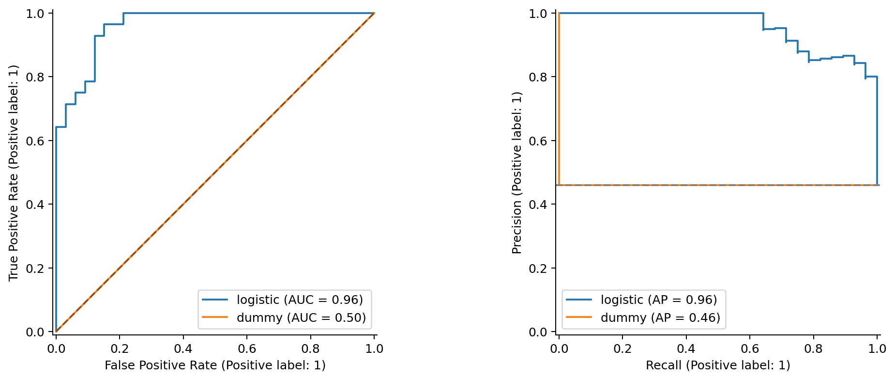

## 11. Đánh giá độc lập: Readmission

Mô hình xgboost được chọn bằng CV development, không chọn bằng test. Test ap=0.2289, ROC-AUC=0.6695, AP=0.2289. Tại threshold 0.090540, TP=1788, TN=7983, FP=9729, FN=531; recall=0.7710, precision=0.1552, specificity=0.4507, tỷ lệ gắn cờ=57.50%. Đánh giá encounter-level trên bệnh nhân chưa xuất hiện ở phần fit. Ranking còn khiêm tốn và tải false alarm cao; chưa chứng minh hiệu ích lâm sàng.

Bảng dùng threshold của từng recipe được chọn trên development; không phải accuracy tại mặc định0.5. Dummy tối đa F2 gắn cờ tất cả, nên accuracy của nó ở operating point này khác always-negative0.5. Ranking AP/AUC vẫn là baseline không phụ thuộc threshold.

Bootstrap1000 fixed-prediction resamples giữ label/probability đi cùng. Heart dùng rows giả định độc lập; readmission lấy bệnh nhân có hoàn lại và giữ toàn bộ encounters với multiplicity. CI không bao gồm biến động do training/model selection hoặc distribution shift.

AP0.229 so prevalence0.116 cho thấy ranking có thông tin, nhưng chất lượng absolute còn khiêm tốn. Không tăng điểm bằng chia ngẫu nhiên encounter lặp. Chênh lệch XGB–LR AP khoảng0.012 với CI paired dương; chênh lệch F2 có CI chứa0, nên tăng ranking không bảo đảm cải thiện vận hành cùng mức chắc chắn.

**Test của các recipe**

| model               | feature_set   |   roc_auc |    ap |   recall |   precision |
|:--------------------|:--------------|----------:|------:|---------:|------------:|
| dummy               | full          |     0.5   | 0.116 |    1     |       0.116 |
| logistic            | full          |     0.662 | 0.217 |    0.76  |       0.155 |
| logistic_balanced   | full          |     0.665 | 0.218 |    0.809 |       0.149 |
| gaussian_nb         | numeric       |     0.616 | 0.191 |    0.903 |       0.124 |
| xgboost             | full          |     0.669 | 0.229 |    0.771 |       0.155 |
| random_forest       | full          |     0.655 | 0.206 |    0.814 |       0.145 |
| logistic_engineered | engineered    |     0.655 | 0.214 |    0.844 |       0.136 |

**CI95% của recipe chọn bằng development**

| metric   |   point |   lower |   upper |
|:---------|--------:|--------:|--------:|
| roc_auc  |   0.669 |   0.656 |   0.682 |
| ap       |   0.229 |   0.208 |   0.25  |
| brier    |   0.098 |   0.094 |   0.101 |

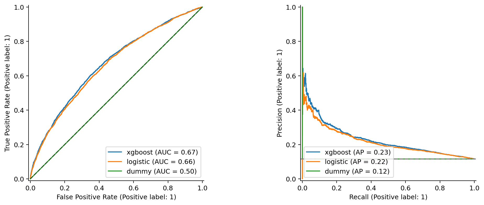

## 12. Calibration: chất lượng xác suất có thể suy giảm

Discrimination đánh giá xếp hạng dương/âm; calibration kiểm tra xác suất so với tỷ lệ quan sát. ROC-AUC/AP tốt không tự chứng minh p có nghĩa như tần suất. Brier đo tổng sai số xác suất, không tách riêng calibration; dùng cùng log loss và reliability diagram.

Sigmoid fit bằng calibration holdout; raw/calibrated được so Brier trên threshold holdout trước test. Heart chọn sigmoid vì cải thiện rất nhỏ khoảng0.00084 trên37 quan sát. Test Brier raw0.0859 nhưng sigmoid0.1058; log loss cũng xấu hơn. Đây là kết quả bất lợi cần giữ và giải thích, không đổi recipe sau khi xem test.

Một giả thuyết hợp lý là calibration set36 quan sát không đủ ổn định, có sampling fluctuation hoặc khác mức phân bố xác suất. Chưa có bằng chứng để khẳng định duy nhất overfitting là nguyên nhân. Hướng tương lai là cross-fitting hoặc calibration set lớn hơn, cần một đánh giá mới độc lập.

Readmission có calibration10.083 encounters tách theo patient, thuận lợi hơn về cỡ mẫu. Reliability plot dùng quantile bins; axes readmission zoom theo bin means để đọc rõ vùng xác suất thấp. Raw và calibrated ở cùng numeric threshold chỉ là chẩn đoán, không đại diện hai policy được tối ưu lại công bằng.

**Chất lượng xác suất trên test**

| Dataset     | Probability       |   Brier |   Log_loss |
|:------------|:------------------|--------:|-----------:|
| heart       | raw               |  0.0859 |     0.2969 |
| heart       | sigmoid_candidate |  0.1058 |     0.3693 |
| readmission | raw               |  0.0975 |     0.3382 |
| readmission | sigmoid_candidate |  0.0975 |     0.3382 |

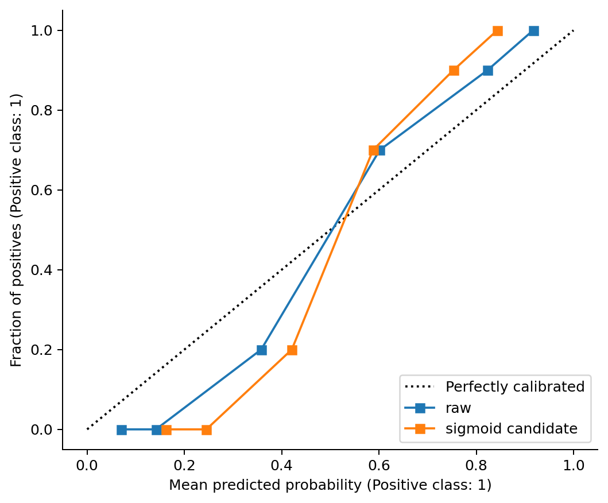

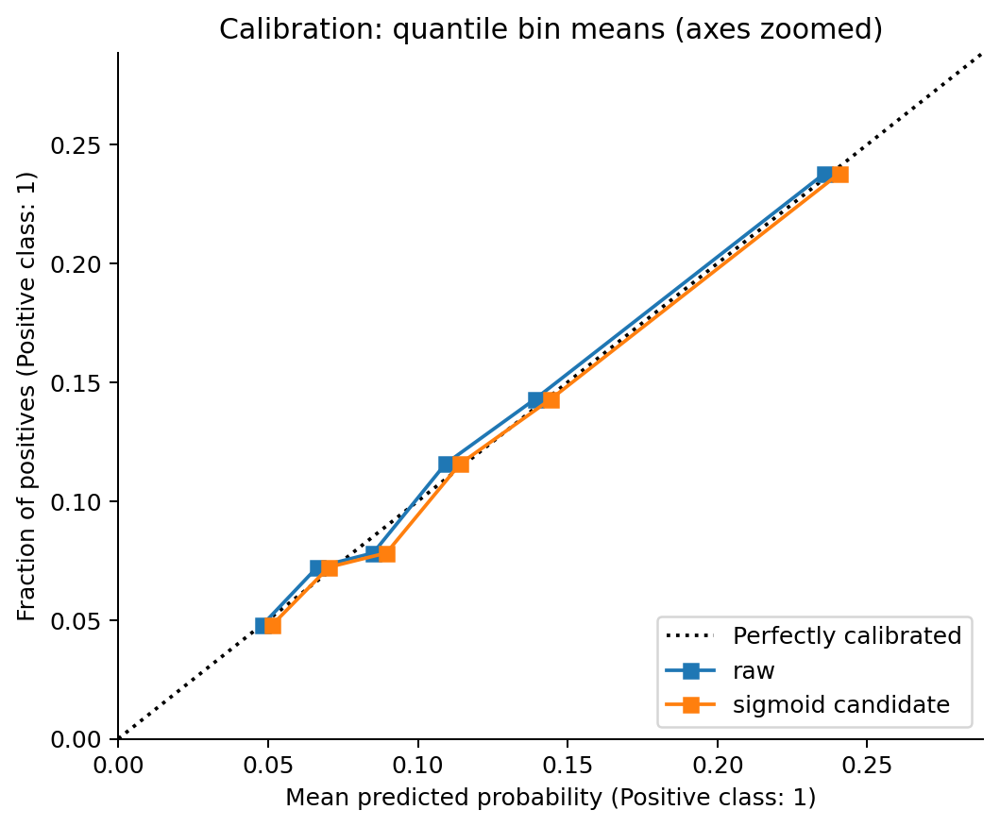

## 13. Threshold, bỏ sót và tải cảnh báo

Threshold0.5 là mặc định, không phải tối ưu phổ quát. Quy tắc F2 ưu tiên recall, được chọn trên threshold holdout độc lập. Khi giảm threshold, alert count/recall thường tăng; precision không bảo đảm giảm đơn điệu. Probability và label quyết định cần được trình bày riêng.

Readmission tại0.5 chỉ TP32, FN2287 và FP25: bỏ sót phần lớn ca tái nhập viện sớm. Ngưỡng F2 khoảng0.0905 đưa TP lên1788 nhưng FP lên9729, hơn57% encounters được gắn cờ. Vì vậy sensitivity77% không đủ để đánh giá policy hữu ích khi tải xử lý bị giới hạn.

Heart tuned threshold phát hiện28/28 positives nhưng có14 FP, specificity57.6%. Đây là đánh đổi được chốt trên development, không phải chuẩn lâm sàng. Ràng buộc recall>=0.85 chỉ là scenario học thuật; recall validation không bảo đảm đạt cùng mức trên test.

Các cost ratios C_FN:C_FP=1:1,2:1,5:1 được chọn threshold trên development và đánh giá cố định trên test. Đây là phân tích giả định, không phải số tiền bệnh viện hoặc utility lâm sàng thật. Không dùng test để chọn tỷ lệ thuận lợi nhất.

**Operating points đã chốt**

| Dataset     | Policy   |   Threshold |   Recall |   Precision |   FP |   FN |   Alert |
|:------------|:---------|------------:|---------:|------------:|-----:|-----:|--------:|
| heart       | 0.5      |      0.5    |   0.9286 |      0.8387 |    5 |    2 |  0.5082 |
| heart       | f2       |      0.2693 |   1      |      0.6667 |   14 |    0 |  0.6885 |
| readmission | 0.5      |      0.5    |   0.0138 |      0.5614 |   25 | 2287 |  0.0028 |
| readmission | f2       |      0.0905 |   0.771  |      0.1552 | 9729 |  531 |  0.575  |

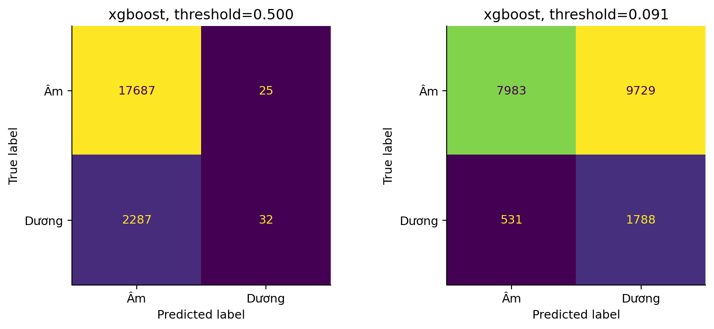

## 14. Ngân sách gắn cờ và giá trị của ranking

Theo Slide3 trang48, một danh sách có ngân sách cố định cần precision@k và recall@k. K được xác định trước bằng5/10/20% encounters test, sort ổn định để xử lý ties. Không chọn mức k bằng nhãn test.

Top5% tương ứng1002 encounters, tìm321 positives: precision32.0% nhưng recall13.8%. Top10% là2004 lượt, tìm546 positives: precision27.2%, recall23.5%. Top20% là4007 lượt, tìm899: precision22.4%, recall38.8%. Mở rộng ngân sách tìm thêm positives nhưng tăng số ca âm được xem xét.

Đơn vị là encounter, không phải số bệnh nhân duy nhất; một người có thể có nhiều lượt trong test. Để xây policy bệnh nhân cần định nghĩa thời gian, hợp nhất alerts và có metadata theo dõi phù hợp. Dữ liệu hiện tại chưa đáp ứng temporal deployment claim.

AP tổng hợp chất lượng positive ranking trên nhiều ngưỡng; không đồng nhất AP với PR-AUC hình thang. Top-k bổ sung ý nghĩa vận hành vì một bệnh viện có thể không xử lý được57% encounters dù threshold F2 đạt recall cao.

Phát hiện này trả lời RQ2: metric tối ưu và cơ chế quyết định phải phù hợp mục tiêu. Một ngưỡng học thuật tốt không thay thế xác định nguồn lực, mức chấp nhận FN/FP và kiểm chứng triển khai.

**Ngân sách định trước trên test**

|   fraction |    k |   positive_found |   precision_at_k |   recall_at_k |
|-----------:|-----:|-----------------:|-----------------:|--------------:|
|       0.05 | 1002 |              321 |            0.32  |         0.138 |
|       0.1  | 2004 |              546 |            0.272 |         0.235 |
|       0.2  | 4007 |              899 |            0.224 |         0.388 |

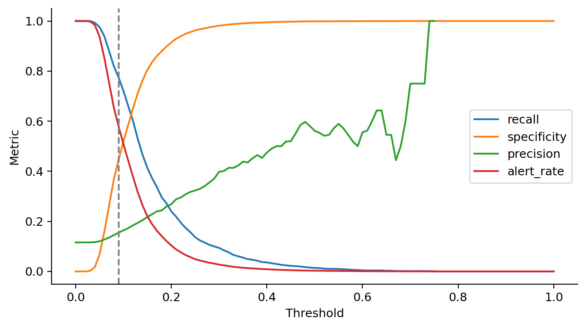

## 15. Phân tích lỗi và case studies: Heart

Recipe Heart không có FN tại threshold tuned. Báo cáo không tạo ca FN giả; chọn2 FP,1 TP và1 TN để đối chiếu. Không có FN trên61 test rows chưa chứng minh không bỏ sót ở dữ liệu mới.

Confidence ở đây là p khi operating label=1 và1-p khi label=0. Với threshold<0.5, max(p,1-p) có thể ưu tiên FP có xác suất dương thấp nhưng policy vẫn gắn cờ; vì vậy không dùng max(p,1-p) để gọi đó là FP tự tin.

So sánh FN với TP và FP với TN bằng counts, numerical features và missingness, không suy ra nguyên nhân từ một quan sát. Sai confidence cao có thể do overlap lớp, thiếu yếu tố dự báo, outcome không được quan sát ngoài hệ thống hoặc shift; chưa thể kết luận nhãn sai.

Local explanations dùng raw model output trước calibration. Nếu một biến góp phần tăng score cho FP, nó mô tả cách model sử dụng thông tin, không chứng minh biến đó gây tái nhập viện/bệnh tim. Các đề xuất thu thập feature tốt hơn cần thực nghiệm mới, không retune bằng error cases test.

Bảng dưới giữ anonymous audit keys để truy nguyên artifact; không giải thích lâm sàng về điều trị. Với readmission, lịch sử number_inpatient là tín hiệu mạnh nhưng không thể giải thích mọi ca; một người chưa có nhiều nhập viện vẫn có thể thuộc lớp dương.

**Các ca đối chiếu từ recipe frozen**

|   row_id |   y |   probability |   prediction | error_type   |   confidence |
|---------:|----:|--------------:|-------------:|:-------------|-------------:|
|      271 |   0 |      0.682421 |            1 | FP           |        0.682 |
|      196 |   0 |      0.633583 |            1 | FP           |        0.634 |
|       76 |   1 |      0.88775  |            1 | TP           |        0.888 |
|      302 |   0 |      0.114159 |            0 | TN           |        0.886 |

**Numerical means theo nhóm lỗi**

| error_type   |    age |   trestbps |    chol |   thalach |   oldpeak |
|:-------------|-------:|-----------:|--------:|----------:|----------:|
| FP           | 56.429 |    135.357 | 237.714 |   152.071 |     0.721 |
| TN           | 48.158 |    128.158 | 222.474 |   162.211 |     0.432 |
| TP           | 56.75  |    138.571 | 240.429 |   136.75  |     1.961 |

## 16. Phân tích lỗi và case studies: Readmission

Recipe readmission có531 FN và9729 FP. Chọn2 FN,2 FP,1 TP và1 TN từ predictions cố định để phân tích, ưu tiên xác suất của nhãn được gắn. Những ca này minh họa model behavior, không đại diện toàn bộ quần thể.

Confidence ở đây là p khi operating label=1 và1-p khi label=0. Với threshold<0.5, max(p,1-p) có thể ưu tiên FP có xác suất dương thấp nhưng policy vẫn gắn cờ; vì vậy không dùng max(p,1-p) để gọi đó là FP tự tin.

So sánh FN với TP và FP với TN bằng counts, numerical features và missingness, không suy ra nguyên nhân từ một quan sát. Sai confidence cao có thể do overlap lớp, thiếu yếu tố dự báo, outcome không được quan sát ngoài hệ thống hoặc shift; chưa thể kết luận nhãn sai.

Local explanations dùng raw model output trước calibration. Nếu một biến góp phần tăng score cho FP, nó mô tả cách model sử dụng thông tin, không chứng minh biến đó gây tái nhập viện/bệnh tim. Các đề xuất thu thập feature tốt hơn cần thực nghiệm mới, không retune bằng error cases test.

Bảng dưới giữ anonymous audit keys để truy nguyên artifact; không giải thích lâm sàng về điều trị. Với readmission, lịch sử number_inpatient là tín hiệu mạnh nhưng không thể giải thích mọi ca; một người chưa có nhiều nhập viện vẫn có thể thuộc lớp dương.

**Các ca đối chiếu từ recipe frozen**

|      row_id |   y |   probability |   prediction | error_type   |   confidence |
|------------:|----:|--------------:|-------------:|:-------------|-------------:|
| 1.42665e+08 |   1 |     0.030929  |            0 | FN           |        0.969 |
| 1.76179e+08 |   1 |     0.0338559 |            0 | FN           |        0.966 |
| 2.77606e+08 |   0 |     0.739992  |            1 | FP           |        0.74  |
| 2.91808e+08 |   0 |     0.690657  |            1 | FP           |        0.691 |
| 3.09563e+08 |   1 |     0.754566  |            1 | TP           |        0.755 |
| 4.72283e+07 |   0 |     0.0237191 |            0 | TN           |        0.976 |

**Numerical means theo nhóm lỗi**

| error_type   |   time_in_hospital |   num_medications |   number_inpatient |   number_emergency |   num_lab_procedures |
|:-------------|-------------------:|------------------:|-------------------:|-------------------:|---------------------:|
| FN           |              3.488 |            14.156 |              0.043 |              0.066 |               39.789 |
| FP           |              5.116 |            17.642 |              1.025 |              0.296 |               45.286 |
| TN           |              3.374 |            13.86  |              0.042 |              0.055 |               39.836 |
| TP           |              5.01  |            17.547 |              1.639 |              0.456 |               44.889 |

## 17. Subgroup analysis và giới hạn suy luận fairness

Phân tích trước các nhóm tuổi/giới, race khi có, sử dụng dịch vụ trước đó và missingness. Chỉ diễn giải metric khi nhóm có ít nhất30 observations và10 positives/10 negatives. Nhóm không đủ count vẫn có thể mô tả số lượng nhưng các metric suy luận gắn NA.

Heart nhỏ nên nhiều nhóm không đạt yêu cầu; không cố chia nhiều khoảng để tìm chênh lệch đẹp. patient identity không xác thực khiến giới hạn giả định độc lập vẫn còn. Không gọi thiếu chênh lệch quan sát là bằng chứng công bằng.

Readmission là dữ liệu hệ thống chăm sóc lịch sử; nhãn và khả năng tái nhập viện quan sát được có thể khác theo nhóm. Chênh lệch precision có thể chịu ảnh hưởng prevalence ngoài chất lượng phân loại. Cần counts và uncertainty thay vì chỉ so hai số recall.

Subgroup analysis là hậu kiểm mô tả, không chứng minh phân biệt đối xử hay tác động nhân quả. Những nhóm nhỏ, dữ liệu missing và outcome ngoài hệ thống cần được xem là hạn chế. Chưa làm subgroup-calibrated deployment hoặc thử nghiệm prospective.

Kết quả đủ hỗ trợ RQ4 về nơi model dễ sai, nhưng chưa đủ kết luận một policy lâm sàng công bằng. CSV đầy đủ có các nhóm age/missingness và điều kiện đủ count để kiểm tra lại.

**Ví dụ nhóm đáp ứng count tối thiểu**

| Dataset     | Feature   | Group           |     n |   Positive |   Recall |   Precision |     AP |
|:------------|:----------|:----------------|------:|-----------:|---------:|------------:|-------:|
| heart       | sex       | 1.0             |    41 |         21 |   1      |      0.6562 | 0.9465 |
| readmission | gender    | Female          | 10898 |       1280 |   0.7758 |      0.153  | 0.2295 |
| readmission | gender    | Male            |  9133 |       1039 |   0.7652 |      0.1581 | 0.2293 |
| readmission | race      | AfricanAmerican |  3848 |        476 |   0.7626 |      0.1688 | 0.2247 |
| readmission | race      | Asian           |   135 |         18 |   0.7222 |      0.2097 | 0.4442 |
| readmission | race      | Caucasian       | 14880 |       1706 |   0.7773 |      0.152  | 0.2321 |
| readmission | race      | Hispanic        |   431 |         51 |   0.7843 |      0.197  | 0.28   |
| readmission | race      | Other           |   288 |         32 |   0.6875 |      0.1477 | 0.2217 |
| readmission | race      | nan             |   449 |         36 |   0.6667 |      0.1043 | 0.1097 |

## 18. Giải thích mô hình và các yếu tố liên quan

Permutation importance dùng5 lần hoán vị, sample tối đa2000 test rows seed47 và primary ranking metric của raw pipeline. Đây là hậu kiểm không chọn lại features. SD của phép hoán vị không phải CI tổng quát của tác động biến.

Biến tương quan có thể chia sẻ importance, làm individual importance thấp hoặc không ổn định. Các feature permutation có thể tạo tổ hợp ít xuất hiện; do đó importance đo model reliance, không xác lập quan hệ nhân quả.

Heart dùng LinearExplainer với background80 fit rows; contributions ở raw log-odds. Readmission dùng native exact TreeSHAP vì SHAP0.49 không đọc vector base_score của XGB3.2. Background native là training node cover, không gọi là interventional80-row sample. Tổng contributions+base được đối chiếu với raw margins.

Gom one-hot contributions về biến gốc bằng tổng trong từng case. Mean absolute SHAP trên các case được chọn chỉ là minh họa local, không phải global population importance. Bảng và code giữ encoded values để kiểm toán.

Numerical LR odds ratio được diễn giải theo1 SD train. Với full one-hot, category contrast cần chênh lệch hai hệ số; exp(coef) riêng không phải odds ratio tự nhiên so reference. Regularization và covariance giữa biến cũng hạn chế diễn giải.

**Các biến có permutation importance cao**

| Dataset     | Feature                  |   Decrease |     SD |
|:------------|:-------------------------|-----------:|-------:|
| heart       | oldpeak                  |     0.0381 | 0.0106 |
| heart       | cp                       |     0.026  | 0.0059 |
| heart       | ca                       |     0.0253 | 0.0148 |
| heart       | thal                     |     0.0154 | 0.0075 |
| heart       | thalach                  |     0.0102 | 0.0127 |
| readmission | number_inpatient         |     0.0534 | 0.004  |
| readmission | discharge_disposition_id |     0.0353 | 0.0022 |
| readmission | diag_1                   |     0.012  | 0.003  |
| readmission | diag_3                   |     0.0046 | 0.0019 |
| readmission | A1Cresult                |     0.0026 | 0.0008 |

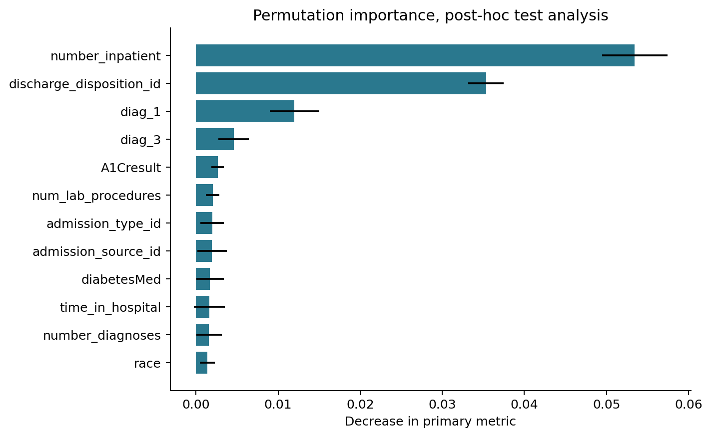

## 19. Ablation và các phương pháp không cải thiện

E02 giữ cùng C/penalty/features/folds khi đổi class weights; E05/E06 giữ cùng hyperparameters khi đổi feature set; E09 giữ k/distance/weights khi đổi scaling. Các đối chứng này giúp tránh quy chênh lệch do nhiều yếu tố cùng đổi cho một nguyên nhân.

KNN Heart scaled có CV AUC cao hơn unscaled rõ rệt. Tác động khớp nội dung khoảng cách/đơn vị đo trong Slide4, nhưng vẫn phụ thuộc encoder và feature geometry. Việc k lớn hơn tốt ở miền đã thử không chứng minh k nên tăng vô hạn.

LR readmission balanced hơi tăng AP nhưng raw Brier tăng từ khoảng0.095 lên0.222 trong đối chứng development. Weighting đổi objective/phân phối học, nên probability quality cần kiểm tra và threshold phải chọn lại; không chỉ công bố recall cải thiện.

Engineered feature set không cải thiện AP development so full; gộp diagnoses có thể giảm chi tiết và không tạo thêm tín hiệu độc lập. Restricted Heart bỏ ca/thal giảm CV AUC, phù hợp việc giảm thông tin xét nghiệm, nhưng diễn giải chỉ là đánh đổi trong thiết kế này.

E08 cho thấy C lớn tăng training score nhưng không nhất thiết tăng validation score; L1 tạo thưa rõ trên readmission. Kết quả không cải thiện có giá trị vì giúp trả lời câu hỏi thay vì chỉ giữ thí nghiệm thuận lợi.

**Đối chứng development giữ điều kiện còn lại**

| Dataset     | Variant            |    AUC |     AP |   Brier |
|:------------|:-------------------|-------:|-------:|--------:|
| heart       | E02_weighted_False | 0.9193 | 0.9245 |  0.1183 |
| heart       | E02_weighted_True  | 0.9193 | 0.9249 |  0.1187 |
| heart       | E06_full           | 0.9193 | 0.9245 |  0.1183 |
| heart       | E06_restricted     | 0.8888 | 0.8902 |  0.1406 |
| heart       | E09_scaling_False  | 0.7781 | 0.8025 |  0.191  |
| heart       | E09_scaling_True   | 0.9143 | 0.9204 |  0.1175 |
| readmission | E02_weighted_False | 0.666  | 0.2133 |  0.0955 |
| readmission | E02_weighted_True  | 0.6674 | 0.2144 |  0.2225 |
| readmission | E05_engineered     | 0.6648 | 0.2112 |  0.0956 |
| readmission | E05_full           | 0.666  | 0.2133 |  0.0955 |

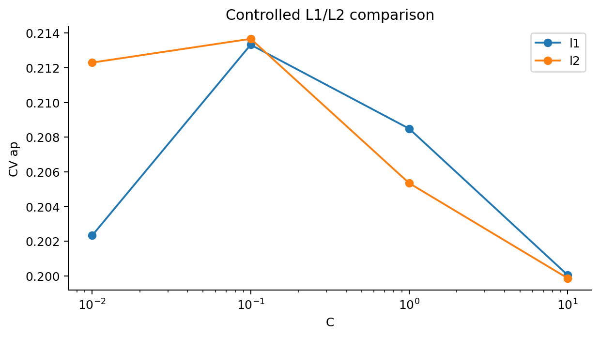

## 20. Mở rộng thực nghiệm: split conformal

Dùng raw Logistic Regression Heart đã chọn/tune bằng fit; conformal calibration set riêng36 observations, score=1-p(true class). Quantile dùng rank ceil((n+1)*(1-alpha)); nếu rank vượt n, dùng bound1. Alpha0.05 và0.10 định trước.

Prediction set gồm nhãn c nếu1-p(c)<=qhat. Coverage test quan sát bằng1 ở cả hai alpha nhưng average set size khoảng1.885/1.541; ambiguous rate88.5%/54.1%. Coverage cao đi cùng nhiều tập{0,1}, nên không thể gọi là phân loại hoàn hảo hoặc certainty.

Conformal chỉ có bảo đảm biên dưới exchangeability giữa calibration/test; không đảm bảo cho từng người hoặc subgroup. Heart không có patient ID được xác minh, nên independence/exchangeability là giả định. Không áp dụng bảo đảm row-iid cho readmission encounters lặp.

Phần này vượt phạm vi sáu slide nhưng conformal nền tảng không phải kỹ thuật mới nhất. Literature review cập nhật nghiên cứu distribution shift và các thế hệ tabular foundation models; phân biệt thuật toán đã chạy với paper đã đọc.

RQ5: lợi ích bổ sung là trình bày ambiguity và coverage/size trade-off, không nhất thiết tăng accuracy. Chưa có prospective validation hoặc conformal dưới shift được triển khai; các phương pháp gần đây là hướng nghiên cứu tiếp theo.

**Conformal test, raw LR cố định**

|   alpha |   coverage |   mean_set_size |   singleton_rate |   ambiguous_rate |   empty_rate |
|--------:|-----------:|----------------:|-----------------:|-----------------:|-------------:|
|    0.05 |          1 |           1.885 |            0.115 |            0.885 |            0 |
|    0.1  |          1 |           1.541 |            0.459 |            0.541 |            0 |

## 21. Kiến thức mới và tổng hợp với môn học

Sáu slide xác nhận Logistic Regression, KNN, Gaussian/Naive Bayes, MLE/MAP, regularization, CV/group split, threshold, calibration, learning curves và bootstrap. Không lấy calibration/bootstrap làm ví dụ kiến thức hoàn toàn ngoài môn học. Post-hoc calibration/cross-fitting đi sâu hơn phần kiểm tra cơ bản.

Nature2025 giới thiệu TabPFN cho small/medium tabular data; technical reports2.5 và3.5 là các mốc nghiên cứu sau đó đã được kiểm chứng trước11/10/2026. Các báo cáo benchmark thuộc tác giả, không phải metric của hai splits hiện tại; không khẳng định model mới chắc chắn tốt hơn boosting trong dự án.

TabPFN ở đây là skipped feasibility review theo phạm vi/ngân sách, chưa tải checkpoint hoặc chạy, không có failed/blocked run. Model card v2 công khai; repository bản mới mô tả auth/license flow. Không suy v2 gated chỉ từ bản mới và không ghi một thông báo lỗi tải giả.

Nghiên cứu conformal dưới non-exchangeability/distribution shift2025–2026 giúp hiểu giới hạn bảo đảm hiện có. Dự án không triển khai optimal transport hoặc shift diagnostics của các paper mới, nên chỉ trích dẫn như literature review.

Ánh xạ course_alignment chỉ rõ PDF page từ1, không số chân slide. GMM/EM đã học nhưng không bắt buộc một thí nghiệm clustering rời rạc. Ensemble/SHAP là bổ sung; phần cập nhật mới được phân loại riêng, không dùng marketing SOTA hoặc cộng trung bình AUC hai outcome.

## 22. Trả lời câu hỏi nghiên cứu và hạn chế

RQ1: LR là lựa chọn development cho Heart; XGB cho readmission. Test assessment hỗ trợ ranking có thông tin ở cả hai, nhưng mức hiệu năng và độ bất định rất khác. Không thể xếp hai outcome trên một thang clinical utility chung.

RQ2: threshold0.5 bỏ sót đa số readmission positives; F2 tăng detection nhưng tạo nhiều FP. Top-k cho thấy mức nguồn lực và phần ca dương tìm được. Policy vận hành cần mục tiêu/chi phí được xác định ngoài test.

RQ3: calibration Heart xấu hơn trên test; giữ kết quả bất lợi và recipe. RQ4: FN/FP, missingness, subgroup và explanations cho thấy model limitations; không chứng minh label noise hoặc nhân quả. RQ5: conformal tăng khả năng biểu đạt uncertainty với ambiguity lớn, còn TabPFN chỉ review.

Giới hạn: dữ liệu lịch sử và cohort selection; Heart test61, cal36; IDs Heart tổng hợp; readmission outcomes ngoài hệ thống; thiếu timestamps/hospital ID đáng tin. Chưa temporal/external validation. CV selection có optimism; bootstrap chỉ fixed model; cỡ subgroup và correlation hạn chế inference.

Thời gian/tài nguyên ảnh hưởng search budget RF. Model cuối không fit toàn bộ development; chưa triển khai nested cross-fitting. Hướng tiếp theo có thể tăng calibration data, bổ sung features/metadata hợp lệ, prospective validation và thử foundation model local theo license; mọi thay đổi cần đánh giá độc lập mới.

## 23. Tái lập, kiểm định và sản phẩm bàn giao

Python3.10.11, scikit-learn1.7.2, CPU tối đa2 luồng/model. Môi trường riêng .venv và requirements-lock.txt. Windows Unicode paths cần PYTHONUTF8=1 cho editable install; threadpoolctl3.6.0 tránh lỗi snapshot path3.7. Không hứa deterministic tuyệt đối trên mọi nền tảng.

12 tests kiểm tra target/schema, group disjoint ở tất cả partitions/folds, missing None, ID exclusion, unknown categories, train-only statistics, save/load predictions, cluster multiplicity, gradient, frozen hashes và threshold truy nguyên development. Bốn notebook đã chạy từ kernel sạch, không có error outputs.

README mô tả tạo môi trường, smoke/full commands, CLI và cache. Smoke chỉ kiểm tra wiring, tách artifacts/smoke khỏi full. Sau freeze, train/evaluate tái sử dụng artifact để tránh test tuning. Một nghiên cứu mới cần checkout/protocol/evaluation mới, không xóa manifest để chọn điểm đẹp trên cùng test.

Data cards/source.json chứa URLs, DOI, license, SHA-256, raw/processed/split provenance. Runs chứa trial params, warnings, durations và cancelled RF evidence. Báo cáo đọc CSV/JSON/PNG đã chạy, không huấn luyện lại hoặc chèn metric giả.

PDF và PPTX được sinh cục bộ khi artifact runtime không có sẵn, dùng font hỗ trợ tiếng Việt. Các bảng/chart so sánh trong deck chỉnh sửa được; đồ thị khoa học gốc kèm PNG/CSV/code. Kiểm tra render thực tế; không đánh giá chỉ bằng file tồn tại. Demo chạy local, chưa publish/nộp thay sinh viên.

## Tài liệu tham khảo

# Tổng quan tài liệu và tính khả thi của phần mở rộng

Ngày kiểm chứng: **11/10/2026**. Chỉ dùng các công bố có ngày xuất hiện không sau ngày này. Phần dưới diễn giải ngắn nguồn gốc, không chép abstract và không coi điểm trong bài báo là điểm của dự án. Trạng thái thực nghiệm được xác định bằng artifact, không bằng việc cài thư viện.

| Nguồn và ngày | Loại nguồn | Đóng góp, liên quan | Giới hạn và trạng thái trong dự án |
|---|---|---|---|
| [UCI Heart Disease](https://archive.ics.uci.edu/dataset/45/heart+disease), DOI 10.24432/C52P4X | Kho dữ liệu gốc | Cleveland có 303 quan sát, 13 đầu vào; nhãn gốc 0–4. Dự án dùng `num > 0` và giữ nguồn CC BY 4.0. | Phân loại bệnh hiện diện khi đã có xét nghiệm. ID audit tạo từ hàng không xác nhận danh tính bệnh nhân. Thực nghiệm dự án dùng riêng Cleveland. |
| [UCI Diabetes 130-US Hospitals](https://archive.ics.uci.edu/dataset/296/diabetes+130-us+hospitals+for+years+1999-2008), DOI 10.24432/C5230J | Kho dữ liệu gốc | Dữ liệu lượt điều trị năm 1999–2008; có ID bệnh nhân và bảng mã. Nhãn dự án là tái nhập viện `<30`; giấy phép CC BY 4.0. | Một bệnh nhân có nhiều lượt. Group split cần giữ toàn bộ lượt cùng người ở một phần. Không có external validation theo bệnh viện hoặc thời gian trong dự án. |
| Hollmann và cộng sự, [Accurate predictions on small data with a tabular foundation model](https://www.nature.com/articles/s41586-024-08328-6), 08/01/2025, Nature 637:319–326 | Bài báo phản biện | TabPFN học cách dự đoán trên dữ liệu bảng thông qua tiền huấn luyện dữ liệu tổng hợp. Liên quan trực tiếp đến Heart nhỏ. | Kết quả benchmark của tác giả không chứng minh hiệu quả trên split dự án. Cần kiểm tra calibration, tài nguyên và khả năng benchmark exposure. Chỉ literature/feasibility review, không chạy TabPFN. |
| Grinsztajn và cộng sự, [TabPFN-2.5](https://arxiv.org/abs/2511.08667), v1 11/11/2025, v2 05/02/2026 | Technical report trên arXiv | Mở rộng khả năng xử lý bảng và giới thiệu distillation nhằm giảm latency. | Tuyên bố benchmark thuộc báo cáo tác giả, không phải xác nhận độc lập của dự án. Không gọi bản này là bản mới nhất. Chỉ review. |
| Jäger và cộng sự, [TabPFN-3.5: Technical Report](https://arxiv.org/abs/2609.17895), v1 15/09/2026, v2 22/09/2026 | Technical report trên arXiv | Nghiên cứu dữ liệu nhóm/thời gian và bảng đa dạng hơn. Là mốc gần đây đã kiểm chứng trước ngày thực hiện. | Không suy rằng hỗ trợ grouped benchmark tự động giải quyết leakage của dự án. Chưa thực nghiệm, chưa xác minh ưu thế trên cohort này. |
| [PriorLabs/TabPFN](https://github.com/PriorLabs/TabPFN) và [model card v2](https://huggingface.co/Prior-Labs/TabPFN-v2-clf), kiểm tra 11/10/2026 | Repository/model card chính thức | Phân biệt code, checkpoint, license và cách tải. FAQ của repository mô tả đăng nhập/chấp nhận license cho các phiên bản từ 2.5 trở lên. Model card v2 hiển thị công khai và license riêng. | Chưa probe tải checkpoint, chưa chạy model, không có lỗi tải thực tế. Không quy v2 là gated chỉ vì bản mới có auth flow. Dự án chọn conformal theo phạm vi/ngân sách, trạng thái TabPFN là **skipped: feasibility review**, không phải failed/blocked. |
| Angelopoulos và Bates, [A Gentle Introduction to Conformal Prediction](https://arxiv.org/abs/2107.07511), 15/07/2021, bản v6 07/12/2022 | Tutorial nghiên cứu của tác giả | Split conformal tạo tập nhãn với mức coverage biên dưới giả định exchangeability và calibration độc lập. Cung cấp cơ sở thuật toán mở rộng trên Heart. | Coverage không phải bảo đảm riêng từng bệnh nhân/nhóm. Kỹ thuật nền tảng này đã có trước nghiên cứu gần đây. Chỉ xác nhận thực nghiệm khi có `heart_conformal.json`. |
| Correia và Louizos, [Non-exchangeable Conformal Prediction with Optimal Transport](https://arxiv.org/abs/2507.10425), v1 14/07/2025, v2 24/10/2025, NeurIPS 2025 | Bài nghiên cứu, có journal reference hội nghị | Nghiên cứu mất coverage khi calibration và test khác phân phối, qua optimal transport. | Không biến split conformal chuẩn thành robust conformal. Dự án không triển khai optimal transport; chỉ dùng để nêu điều kiện của bảo đảm. |
| Lee, [Diagnosing Conformal Prediction Failures Under Distribution Shift](https://arxiv.org/abs/2601.00908), v1 01/01/2026, v2 27/08/2026, UAI 2026/PMLR 337 | Nghiên cứu hội nghị, bản tác giả | Nghiên cứu chỉ báo mức tập trung importance và độ nhạy của conformal trước dịch chuyển phân phối. | Ví dụ COVID trong bài không mặc định là dữ liệu lâm sàng tương tự dự án. Chỉ thảo luận; chưa thử diagnostic này hoặc temporal shift trên dữ liệu dự án. |
| Lundberg và Lee, [A Unified Approach to Interpreting Model Predictions](https://arxiv.org/abs/1705.07874), 2017, NeurIPS | Bài nghiên cứu nền tảng | SHAP giải thích đóng góp biến vào đầu ra mô hình. Liên quan phân tích local FP/FN và gom one-hot về biến gốc. | Importance không chứng minh nhân quả. Trong dự án, SHAP nếu có giải thích đầu ra raw trước calibration; background lấy từ fit. Permutation là phân tích global chính. |

## Phân biệt nội dung đã học, mở rộng và nghiên cứu gần đây

Logistic Regression, KNN, Gaussian classifier/Naive Bayes, MLE/MAP, L1/L2, CV, group split, threshold, calibration, learning curves và bootstrap đã xuất hiện trong sáu PDF môn học. Sigmoid calibration triển khai sâu hơn và SHAP/ensemble là phần bổ sung. Split conformal là một mở rộng đã có nền tảng lâu năm. Phần cập nhật nghiên cứu gần đây gồm các thế hệ TabPFN và conformal dưới distribution shift; việc review chúng không tương đương đã chạy chúng.

## Quyết định triển khai

Dự án triển khai conformal trên Heart với LR cố định trên fit, calibration riêng, score `1 - p(true class)` và alpha 0.05/0.10. Đây là lựa chọn triển khai có kế hoạch. Không cần tải checkpoint, không cần tài khoản hoặc đưa dữ liệu lên hosted inference. Chưa có run TabPFN nên không ghi thời gian, metric, release/package cài đặt hay thông báo lỗi giả. Các trang nguồn động mô tả tình trạng tại ngày kiểm tra, không thay thế manifest của một thực nghiệm.

Tính độc lập của quan sát Heart là giả định do không có patient ID xác thực. Không áp dụng bảo đảm row-iid của conformal chuẩn cho readmission có encounter lặp. Tập `{0,1}` thể hiện chưa phân biệt được lớp; tập rỗng và singleton cần báo tần suất, cùng coverage và kích thước trung bình từ artifact thật.

Tài liệu giảng dạy: Slide1.pdf, Slide2.pdf, Slide3.pdf, Slide4-KNN.pdf, Slide5-Prob-model.pdf, Model-assessment.pdf do người dùng cung cấp; dẫn PDF page trong course_alignment.md.

ICD grouping: Strack và cộng sự (2014), https://pmc.ncbi.nlm.nih.gov/articles/PMC3996476/ .
